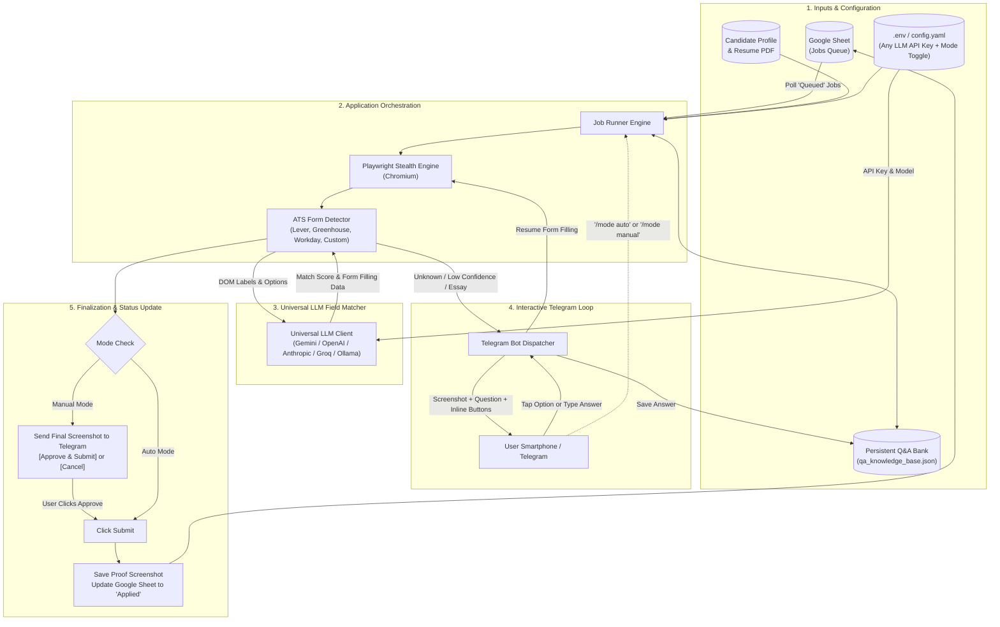

# Job Posting Fraud Detector

Three tools:
1. A classifier trained on the Kaggle "Fake Job Postings" dataset that predicts whether a posting is fraudulent.
2. LinkedIn scrapers (public + authenticated) that fetch live postings and score them with the trained model.
3. An Electron desktop app (`electron-app/`) with a live browser view of the scrape in progress, for both
   the public and authenticated modes — see [4. Live-view Electron app](#4-live-view-electron-app).

## Setup

```bash
pip install -r requirements.txt
```

## 1. Train the model

```bash
python3 src/train.py
```

Trains on `fake-job-posting/job_postings_train.csv` (12,000 labeled rows, ~5% fraudulent),
prints validation metrics, and saves the pipeline to `models/fake_job_classifier.joblib`.

Current validation performance (80/20 held-out split): ROC-AUC ~0.98, recall ~0.86 on the
fraudulent class (catches ~86% of fakes), precision ~0.51 (about half of what it flags is
actually fake — expected given only 5% of postings are fraudulent; tune `--threshold` in
the scoring script to trade off precision/recall).

## 2. Predict on the Kaggle test set

```bash
python3 src/predict.py
```

Writes `data/predictions/submission.csv` (id, fraudulent) and
`data/predictions/test_predictions.csv` (with probabilities, sorted most-suspicious first).

## 3. Scrape LinkedIn + score postings

**Public (no login), low risk:**
```bash
python3 src/score_scraped_jobs.py --mode public --keywords "data analyst" --location "United States" --max-jobs 25
```

**Authenticated (your own account), higher risk — see warnings in `src/scraper/auth_scraper.py`:**
```bash
cp .env.example .env   # fill in LINKEDIN_EMAIL / LINKEDIN_PASSWORD
python3 src/score_scraped_jobs.py --mode auth --keywords "data analyst" --location "United States" --max-jobs 15
```

Both write an Excel workbook to `data/scraped/scored_<keywords>_<timestamp>.xlsx`, sorted most-suspicious
first, with one row per posting and just these columns: Job Role, Company Name, Apply Link (clickable),
Job Profile (description, trimmed to 300 characters so long postings don't blow up the sheet), Required
Experience, Risk Level (Low/Medium/High), and Fraud %.

## 4. Live-view Electron app

`electron-app/` is a desktop GUI with a real, visible browser panel so you can watch the scrape happen —
pages loading, the list scrolling, job detail pages opening — for both modes:

- **Public tab**: navigates the live view to LinkedIn's logged-out job search pages, no login involved.
- **Authenticated tab**: click "Open LinkedIn Login" and sign in *manually* in the live view (your own
  credentials never touch the app's code — this just shows LinkedIn's real login page in an embedded
  browser, same as a normal browser tab). The session persists across app restarts. Once logged in,
  start the scrape from the sidebar.

Under the hood, the same panel you're watching is what gets scraped (via `webContents.executeJavaScript`
reading the DOM) — there's no separate hidden scraper. Extracted postings are sent to the existing trained
model (`src/score_records.py`, spawned as a Python subprocess) for fraud scoring, shown live in a results
table, and can be exported to `.xlsx` via the "Export to Excel" button (uses `exceljs`, no CSV involved) —
same trimmed column set as the CLI: Job Role, Company Name, Apply Link, Job Profile, Required Experience,
Risk Level, Fraud %.

Setup and run:

```bash
cd electron-app
npm install
npm start
```

Notes:
- Requires Node.js and npm. `npm install` downloads the Electron binary from GitHub releases; if your
  network blocks `github.com` (common on corporate/firewalled networks — this happened during development
  here, behind a Sophos-inspected connection), retry with an alternate mirror:
  `ELECTRON_MIRROR="https://npmmirror.com/mirrors/electron/" npm install`.
- On Linux, Electron's sandbox binary (`chrome-sandbox`) usually isn't installed setuid-root by npm, so
  `npm start` runs with `--no-sandbox` (see `package.json`). If you'd rather keep Chromium's OS sandbox
  enabled, run `sudo chown root:root node_modules/electron/dist/chrome-sandbox && sudo chmod 4755
  node_modules/electron/dist/chrome-sandbox` once, then remove `--no-sandbox` from the `start` script.
- Same ToS caveats as the CLI scrapers apply (see below) — keep job counts low, keep the built-in delays.

## Important caveats

- **LinkedIn ToS**: both scrapers violate LinkedIn's Terms of Service. The public one scrapes
  logged-out pages (lower risk, still against ToS); the authenticated one logs into your own
  account (higher risk — can get the account restricted). Keep volume low, keep the built-in
  delays, and use for personal/educational purposes only.
- **Fragility**: LinkedIn's HTML/DOM changes often. If scrapers stop finding job cards or
  descriptions, the CSS selectors in `src/scraper/public_scraper.py` / `auth_scraper.py` likely
  need updating.
- **Model scope**: the classifier was trained on 2014-era Indeed/Kaggle postings. Wording and
  fraud patterns evolve, so treat scores as a triage signal, not ground truth — review anything
  flagged before acting on it.

## Project layout

```
fake-job-posting/          Kaggle train/test/sample_submission CSVs (provided)
src/
  features.py               shared feature engineering + model pipeline definition
  train.py                  trains + saves the model
  predict.py                scores the Kaggle test set (writes .xlsx)
  score_scraped_jobs.py     scrape + score pipeline (entry point for LinkedIn data, CLI, writes .xlsx)
  score_records.py          JSON-in/JSON-out scoring bridge used by the Electron app
  scraper/
    public_scraper.py       no-login scraper (CLI)
    auth_scraper.py         Selenium login-based scraper (CLI)
    schema.py                shared record shape
models/                     saved model (fake_job_classifier.joblib)
data/
  predictions/               Kaggle test set predictions (.xlsx)
  scraped/                   scored LinkedIn scrape outputs (.xlsx)
electron-app/               live-view GUI (public + authenticated), exports .xlsx
  main.js                    window/BrowserView management, IPC, Excel export
  preload.js                 contextBridge API exposed to the renderer
  scraper/orchestrator.js    navigates + scrolls + reads the DOM of the live view
  python/bridge.js           spawns src/score_records.py for fraud scoring
  renderer/                  sidebar UI (tabs, controls, log, results table)
```


new project 

# Autonomous Job Application Engine with Human-in-the-Loop (HITL)

## Goal Description
Build an autonomous, resilient job application automation system capable of reading target job openings from a user-managed **Google Sheet**, navigating through various Applicant Tracking Systems (ATS) and custom job forms (Greenhouse, Lever, Workday, Ashby, BambooHR, etc.), auto-filling candidate details based on a structured resume profile, and seamlessly escalating to the user via **Telegram Bot** whenever an ambiguous question, custom prompt, or blocker is encountered.

Once the user replies on Telegram, the system permanently records the answer in a dynamic Knowledge Base and resumes the application. Additionally, the user can toggle between **Auto-Approve** and **Manual-Approve** modes anytime (via config or dynamic Telegram command), and can plug in **any LLM API key** (Gemini, OpenAI, Anthropic, Groq, OpenRouter, or local Ollama).

---

## User Review & Confirmed Design Choices

> [!IMPORTANT]
> **Confirmed Choices**:
> 1. **Communication Channel**: **Telegram Bot** confirmed for instant alerts, screenshots, and inline interactive buttons.
> 2. **Submission Mode Toggle**: Configurable default (`auto` vs `manual`) in config/`.env`, plus an interactive runtime toggle command (`/mode`) directly in Telegram.
> 3. **Universal LLM Adapter**: Unified interface (`core/llm_client.py`) allowing you to paste **any API key** (OpenAI, Gemini, Anthropic, OpenRouter, Groq, etc.) with customizable base URLs and model names.

---

## System Architecture



---

## Proposed Directory & File Structure

```
job-agent/
├── .env.example                 # Template for API keys (Telegram, Google, LLM)
├── .env                         # Your active credentials (ignored by git)
├── config/
│   ├── settings.yaml            # Config: submission_mode (auto/manual), timeouts, etc.
│   ├── candidate_profile.yaml   # Structured resume data (contact, exp, edu, skills)
│   └── google_service_account.json # Google Sheets service account key
├── data/
│   ├── resume.pdf               # Resume file to upload
│   └── qa_knowledge_base.json   # Auto-growing memory for user answers
├── core/
│   ├── llm_client.py            # Universal LLM Client (OpenAI, Gemini, Anthropic, Groq, Ollama)
│   ├── sheets_manager.py        # Google Sheets reader & status updater
│   ├── telegram_hitl.py         # Telegram Bot listener, alert sender & mode switcher
│   ├── profile_parser.py        # Candidate data validator
│   ├── browser_controller.py    # Playwright stealth browser wrapper
│   ├── form_matcher.py          # Field extractor & semantic matcher
│   └── ats_adapters/            # Tailored ATS handlers
│       ├── base_adapter.py
│       ├── greenhouse.py
│       ├── lever.py
│       ├── workday.py
│       └── generic_form.py
├── logs/                        # Screenshots and session audit logs
├── main.py                      # Master command-line orchestrator
├── requirements.txt
└── README.md
```

---

## Detailed Component Specifications

### 1. Universal LLM Adapter (`core/llm_client.py`)
Allows you to drop in **any API key** from any major provider, or use free/local providers:

```python
# Support in .env:
# LLM_PROVIDER = "gemini" | "openai" | "anthropic" | "groq" | "openrouter" | "ollama"
# LLM_API_KEY  = "your_api_key_here"
# LLM_MODEL    = "gemini-1.5-flash" | "gpt-4o-mini" | "claude-3-5-sonnet" | "llama-3.3-70b"
# LLM_BASE_URL = "" (optional for local/proxy endpoints)
```
- Standardized `generate_answer(prompt, context)` and `match_fields(form_fields, candidate_profile)`.
- If no API key is provided, the system falls back to strict regex and fuzzy string matching (`rapidfuzz`).

---

### 2. Auto-Approve vs. Manual-Approve Toggle
You can switch modes in two ways:
1. **In `config/settings.yaml` / `.env`**:
   ```yaml
   submission:
     mode: "manual"  # Options: "manual" or "auto"
   ```
2. **Dynamically inside Telegram Chat**:
   - Send `/mode` &rarr; Bot shows inline buttons: `[ 🟢 Switch to Auto ]` | `[ 🟡 Switch to Manual ]`
   - Or send `/mode auto` or `/mode manual` anytime while the bot is running.

**Behavior in Each Mode**:
- **`manual` (Recommended)**: Fills 100% of the form, scrolls down to the submit button, takes a crisp full-page screenshot, sends it to your Telegram with:
  - `[ ✅ Approve & Submit ]`
  - `[ ❌ Skip / Cancel ]`
  - `[ ✏️ Edit a Field ]`
  Only submits upon your click.
- **`auto`**: Fills all fields, verifies no red validation errors exist on the page, clicks Submit automatically, captures the confirmation page, and sends you a celebratory summary on Telegram.

---

### 3. Telegram HITL (Human-in-the-Loop) Handler (`core/telegram_hitl.py`)
When the bot hits an unrecognized question, custom essay prompt, or ambiguous dropdown:
1. Freezes the page and captures an annotated screenshot of the question.
2. Sends a push notification to your phone:
   ```
   🚨 QUESTION BLOCKED: Stripe (Software Engineer)
   "Do you have experience leading Kubernetes cluster migrations?"
   ```
3. If multiple-choice, renders Telegram **Inline Keyboard Buttons**:
   - `[ Yes, 3+ years ]`
   - `[ Yes, 1-2 years ]`
   - `[ No experience ]`
   - `[ ✍️ Type Custom Answer ]`
4. When you tap or reply, it:
   - Types the answer into the browser.
   - Saves it to `data/qa_knowledge_base.json` so you are **never asked again** for future applications.
   - Resumes the application process seamlessly.

---

### 4. Google Sheets Sync (`core/sheets_manager.py`)
- Reads the user-maintained spreadsheet.
- Expected Sheet Layout:
  | Row | Job URL | Company | Role | Status | Applied Date | Proof Screenshot | Error Log |
  | :--- | :--- | :--- | :--- | :--- | :--- | :--- | :--- |
  | 2 | `https://jobs.lever.co/...` | Scale AI | Python Engineer | `Queued` | | | |
- Automatically updates status through lifecycle:
  `Queued` &rarr; `In Progress` &rarr; `Waiting on Telegram` &rarr; `Applied` (or `Failed`).

---

## Verification & Execution Roadmap

### Step 1: Project Scaffolding & Virtual Environment
- Initialize directory structure and create `.env.example`.
- Install dependencies: `playwright`, `playwright-stealth`, `gspread`, `python-telegram-bot`, `pydantic`, `pyyaml`, `litellm` (or direct API clients).
- Run `playwright install chromium`.

### Step 2: Universal LLM Client & Candidate Profile Tests
- Build `core/llm_client.py` and test with any provided API key (or dry-run mock).
- Load and validate `config/candidate_profile.yaml` with schema validation.

### Step 3: Telegram Bot Handshake & Mode Switch Verification
- Connect to your Telegram Bot token and Chat ID.
- Test sending an alert with screenshot attachment and inline choice buttons.
- Test switching `/mode auto` and `/mode manual` dynamically.

### Step 4: Browser Automation & ATS Form Fillers
- Build `core/browser_controller.py` with stealth mode.
- Implement adapters for Greenhouse, Lever, and generic forms.
- Test file upload mechanism (`resume.pdf`).

### Step 5: Google Sheets Integration & Full End-to-End Test
- Test reading rows from Google Sheets.
- Run a live test on a sample job application.
- Verify status and screenshot logging back to Google Sheets and Telegram.
